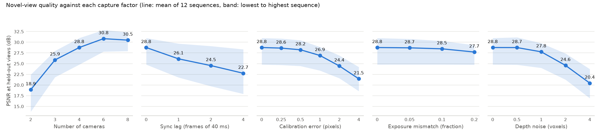
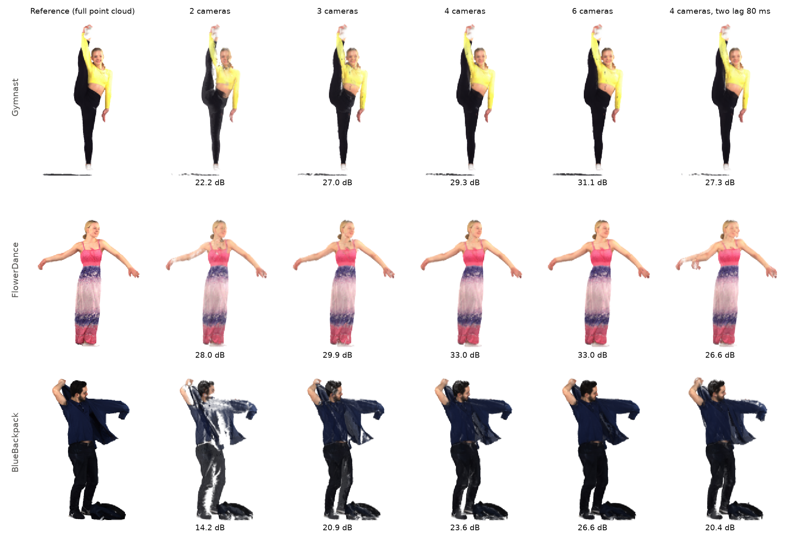

# Loss-resilient Gaussian-splat telepresence

Concealing network packet loss in a multi-camera 3D video call with masked discrete diffusion.

Status: work in progress. The capture and rendering stages are implemented and measured (experiment 01 below);
the codec, the loss simulation and the concealment model are being built. Code and results are added stage by
stage (see [Status](#status)).

## The problem

In a 3D video call, a few cameras film a person and the other side sees them as a 3D object that can be viewed from
any angle, for example in a headset. The 3D representation has to be compressed and sent over a real network many
times per second. Real networks lose packets, and a live call cannot wait for a retransmission. In ordinary 2D video
a lost packet gives a frozen or damaged block. In 3D it removes part of the person: a hole in the body, a missing
arm, or a surface that jumps between frames. These errors are visible from every viewpoint and they are what a
viewer notices first.

The receiver therefore has to fill in what was lost, quickly, and in a way that stays consistent between the
cameras and over time. It should also know which parts of the picture were measured and which were made up.

## Objective

Build one complete, measurable chain from cameras to rendered novel views, and answer four questions with it:

1. **Capture.** How does the quality of the 3D reconstruction depend on the camera rig: number of cameras,
   synchronisation error, calibration error, exposure mismatch and depth noise?
2. **Compression.** How many bits does a frame need when each camera view is turned into a short sequence of
   discrete tokens, compared with a standard video codec (HEVC) at the same quality?
3. **Loss.** How fast does quality at novel views fall when token packets are lost, with the simple receivers used
   today (leave a hole, or copy the previous frame)?
4. **Concealment.** How much of that loss does a masked discrete diffusion model recover when it predicts the
   missing tokens from the received tokens, the other cameras and the previous frame? What does each sampling step
   cost in latency, and is the model's confidence a usable signal of where it is wrong?

A fifth, smaller question uses the same chain: can a screen-space network that receives a cheap splat render from
few cameras (colour, coverage, depth) predict the full-quality image in one pass, and is the result stable over
time?

## Data

[UVG-VPC](https://ultravideo.fi/UVG-VPC/) (Gautier et al., QoMEX 2023): twelve voxelised point-cloud sequences of
people in motion, 250 frames each at 25 frames per second. The 9-bit version is used. The point clouds are the
ground truth: they are filmed by virtual cameras, so camera count, pose, timing, exposure and depth noise are known
exactly and can be changed one at a time.

The dataset is licensed for non-commercial research and is not redistributed here. A script downloads it from the
official source and packs it losslessly.

## Method


- **Capture.** A ring of virtual cameras around the person gives colour, depth and a coverage (alpha) map per view.
- **Representation.** Every foreground pixel becomes one Gaussian at its 3D position, shaped as a thin disc on the
  local surface (pixel-aligned Gaussians). Views are merged and rendered with a Gaussian-splat rasteriser written
  in PyTorch.
- **Tokens.** A convolutional autoencoder with finite scalar quantisation turns each view (colour, alpha, depth)
  into a small grid of discrete tokens. A frame is the token grids of all cameras.
- **Channel.** Tokens are grouped into packets. Packets are dropped independently or in bursts (Gilbert-Elliott
  model).
- **Concealment.** A transformer trained as a masked (absorbing-state) discrete diffusion model. Lost tokens are
  the masked positions; received tokens are kept exactly. The model attends to the tokens of the other cameras and
  of the previous frame, and fills the gaps in a small number of sampling steps.
- **Provenance.** Every Gaussian carries whether it comes from received or generated tokens, so a rendered image
  has a map of measured versus generated pixels.

## Evaluation protocol

- **Viewpoints.** Quality is always measured at six viewpoints that no capture camera occupies: four on the ring
  between cameras and two raised by 20 degrees. The reference is a render of the full point cloud.
- **Metrics.** PSNR (full frame and person region), SSIM, LPIPS, fraction of the person left uncovered, a
  frame-to-frame flicker measure, and the worst 10 % of frames, since a call is judged by its bad moments.
  Bitrate in bits per frame; latency in milliseconds per frame on one GPU.
- **Splits.** Sequences are never split by frame. The dataset shows two people. Five sequences are used for
  training and for tuning, one for validation, and six are held out for testing: two with an outfit not seen in
  training and four of the person not seen in training (`lossysplat/data_split.py`).
- **Baselines.** No concealment; copy of the previous frame; HEVC-coded views at matched bitrate.
- **Seeds.** Learned models are trained with several seeds and gains are reported with their spread.

## Status

| Stage | Question | State |
|---|---|---|
| `01_capture_rig` | Capture | done, results below |
| `02_token_codec` | Compression | in progress |
| `03_packet_loss` | Loss | planned |
| `04_diffusion_concealment` | Concealment | planned |
| `05_screen_space_refinement` | Refinement of cheap renders | planned |

## Results

### Experiment 01: capture rig

No learning and no transmission. Each frame is filmed by the virtual rig, lifted to Gaussians and rendered at the
six held-out viewpoints (256 x 192 pixels, 2 voxels per pixel). The reference rig has 4 cameras with perfect
sensors; one factor is changed at a time. All 12 sequences are used, every 10th frame (25 frames each), so every
row is a mean over 1,800 rendered views. Numbers are in `results/01_capture_rig/results.json`.





One held-out viewpoint of three sequences: the reference render of the full point cloud, then the splat
reconstruction from 2, 3, 4 and 6 cameras, and from 4 cameras when two of them deliver a frame 80 ms late. The
value under each image is its PSNR against the reference for that single frame. With two cameras the sides of
the body are missing; a lagging camera pair doubles the moving limbs. Images are renders of UVG-VPC sequences
(Gautier et al., QoMEX 2023), shown under the dataset's research licence.

| Condition | PSNR (dB) | PSNR, person region (dB) | SSIM | LPIPS | Person left uncovered |
|---|---|---|---|---|---|
| 2 cameras | 18.90 | 11.87 | 0.888 | 0.091 | 19.97 % |
| 3 cameras | 25.86 | 18.85 | 0.943 | 0.040 | 3.16 % |
| 4 cameras (reference) | 28.76 | 21.75 | 0.963 | 0.027 | 1.80 % |
| 6 cameras | 30.83 | 23.85 | 0.977 | 0.020 | 0.65 % |
| 8 cameras | 30.49 | 23.53 | 0.978 | 0.019 | 0.36 % |
| Sync lag of two cameras, 1 frame (40 ms) | 26.11 | 19.19 | 0.943 | 0.041 | 2.31 % |
| Sync lag, 2 frames | 24.54 | 17.69 | 0.930 | 0.054 | 2.72 % |
| Sync lag, 4 frames | 22.74 | 16.03 | 0.912 | 0.075 | 3.29 % |
| Calibration error 0.25 px | 28.63 | 21.62 | 0.962 | 0.028 | 1.81 % |
| Calibration error 0.5 px | 28.23 | 21.23 | 0.960 | 0.029 | 1.85 % |
| Calibration error 1 px | 26.90 | 19.93 | 0.949 | 0.035 | 2.05 % |
| Calibration error 2 px | 24.45 | 17.54 | 0.923 | 0.046 | 2.52 % |
| Calibration error 4 px | 21.45 | 14.70 | 0.881 | 0.066 | 3.37 % |
| Exposure mismatch 5 % | 28.69 | 21.68 | 0.962 | 0.027 | 1.80 % |
| Exposure mismatch 10 % | 28.46 | 21.45 | 0.960 | 0.028 | 1.80 % |
| Exposure mismatch 20 % | 27.71 | 20.70 | 0.955 | 0.032 | 1.80 % |
| Depth noise 0.5 voxel | 28.75 | 21.75 | 0.961 | 0.028 | 1.53 % |
| Depth noise 1 voxel | 27.76 | 20.79 | 0.951 | 0.040 | 1.32 % |
| Depth noise 2 voxels | 24.58 | 17.72 | 0.908 | 0.098 | 1.57 % |
| Depth noise 4 voxels | 20.44 | 13.70 | 0.845 | 0.207 | 6.21 % |

How the factors are defined: for sync, cameras 1 and 3 of the four deliver a later frame than cameras 0 and 2.
For calibration, each camera's assumed orientation is off by a random rotation that moves the image centre by
the stated number of pixels. For exposure, the cameras alternate between a gain above and below one. Depth noise
is Gaussian, per pixel.

## Analysis

- **Timing matters more than calibration at realistic levels.** A lag of one frame between cameras (40 ms) costs
  2.6 dB, more than a 1 px calibration error (1.9 dB). The body moves between frames, so two cameras
  describe two different poses and their surfaces do not meet.
- **Sub-pixel calibration is enough.** Errors up to 0.5 px cost at most 0.5 dB. Quality falls quickly beyond 1 px.
- **Exposure mismatch is the mildest fault.** A 20 % gain difference between neighbouring cameras costs 1.0 dB in
  PSNR. It shows as brightness patches where the cameras' surfaces meet, which a per-pixel metric rates mildly.
- **Depth must be accurate to about half a voxel.** Noise of 0.5 voxel is free, 1 voxel costs 1.0 dB and 2 voxels
  4.2 dB, with LPIPS rising more than threefold. This sets the precision the token codec has to reach for depth.
- **Camera count saturates.** Going from 4 to 6 cameras gains 2.1 dB and removes two thirds of the uncovered
  surface. Eight cameras cover slightly more surface than six but score 0.3 dB lower. The cause has not been
  isolated; the likely one is that more overlapping, slightly misaligned splats blur the surface, since splat
  size and opacity were set once on a 4-camera rig.
- **Hard sequences.** With 4 cameras the per-sequence PSNR ranges from 24.8 dB (BlueBackpack) to 31.0 dB
  (Gymnast). The three lowest (BlueBackpack, ReadyForWinter, BlueSquat) have a backpack, a scarf or a squat,
  which hide parts of the body from a ring of four cameras.

## Limitations

- The splat parameters (size, opacity, thickness) were set by hand on three frames of one training sequence
  (Gymnast), not optimised per scene. Absolute PSNR values would rise with per-scene optimisation; the
  comparisons between conditions are the result.
- In HelloGoodbye the person walks into and out of the capture volume, so its first and last frames show only
  part of the body. On average 9 % of its points lie outside the camera volume; for every other sequence this is
  at most 0.01 %.
- Experiment 01 uses one random draw of calibration error and depth noise per frame and reports no confidence
  intervals; the band in the figure is the range over sequences.

- The cameras are simulated. Real sensors add rolling shutter, lens distortion, lighting changes and depth errors
  that a noise model only approximates.
- The dataset has few people and few outfits, so results on unseen people are a small-sample estimate.
- Masked-token recovery of lost packets has been studied for 2D video (for example Reparo, arXiv:2305.14135).
  This project studies it for multi-view human splats judged at novel viewpoints; it does not claim the idea of
  token-level concealment itself.

## How to reproduce

```
pip install -r requirements.txt
export LOSSYSPLAT_STORE=/path/to/a/data/folder
python scripts/fetch_uvg_vpc.py --out $LOSSYSPLAT_STORE/data/uvg_vpc
python -m pytest tests
python experiments/01_capture_rig/run.py
python experiments/01_capture_rig/plot.py
python experiments/01_capture_rig/figure.py
```

The download is about 1 GB after packing. Experiment 01 takes about five minutes on one GPU.

## Repository layout

```
lossysplat/      library: data access, cameras, renderers, lifting to Gaussians, metrics
experiments/     one folder per stage, numbered as in the table above
results/         small result files and figures, one folder per stage
scripts/         dataset download and packing
tests/           unit tests
```

## References

- Gautier et al., "UVG-VPC: Voxelized Point Cloud Dataset for Visual Volumetric Video-based Coding", QoMEX 2023.
- Kerbl et al., "3D Gaussian Splatting for Real-Time Radiance Field Rendering", SIGGRAPH 2023.
- Mentzer et al., "Finite Scalar Quantization: VQ-VAE Made Simple", arXiv:2309.15505.
- Sahoo et al., "Simple and Effective Masked Diffusion Language Models", arXiv:2406.07524.
- Shi et al., "Simplified and Generalized Masked Diffusion for Discrete Data", arXiv:2406.04329.
- Li et al., "Reparo: Loss-Resilient Generative Codec for Video Conferencing", arXiv:2305.14135.
